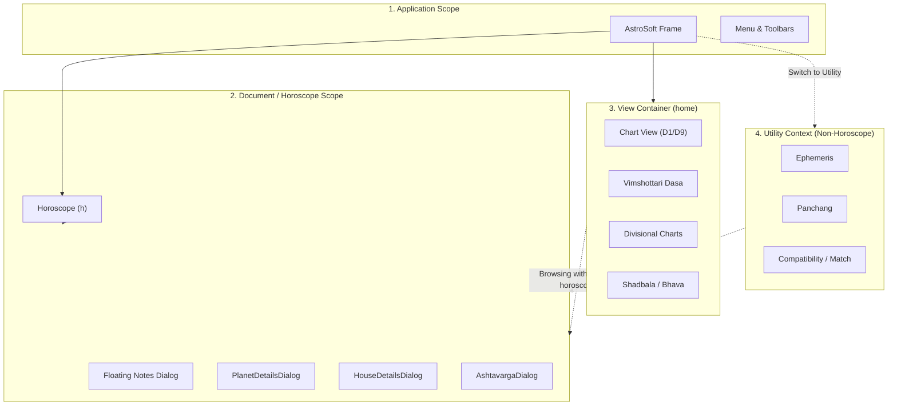

# Specification: Floating Windows Lifecycle & Scope Architecture

**Document Version:** 1.0.0  
**Status:** Approved for Implementation  
**Target:** Astrosoft 2.0 (Java 21 LTS / Swing)  
**Author:** Antigravity & User Pair Programming  

---

## 1. Overview & Objective

In Astrosoft 2.0, several inspection and analysis tools can be detached into modeless floating dialogs:
1. **`PlanetDetailsDialog`** (Planetary positions, Jaimini Karakas, Dignities, and Shadbala strength bars)
2. **`HouseDetailsDialog`** (Comprehensive House PAC — Placement, Aspect, Conjunction analysis)
3. **`AshtavargaDialog`** (Floating 8-chart grid: SAV and 7 planetary Bhinnashtakavarga charts)
4. **`ChartNotesPanel` (`floatingNotesDialog`)** (Popped-out rich text consultation notes editor)

### Problem Statement
Previously, auxiliary dialogs (`PlanetDetailsDialog`, `HouseDetailsDialog`, `AshtavargaDialog`) were not managed during view transitions. When a user opened these dialogs on the main chart and switched to a legacy full-screen view like **Vimshottari Dasa**, the floating windows remained pinned in the center of the screen, occluding the Dasa tree and table. Conversely, closing them aggressively on *any* view switch disrupted the astrologer's multi-window workflow where floating cards serve as cross-referencing heads-up displays (HUDs).

### Objective
Formalize a clean, predictable, scope-based lifecycle:
* **Horoscope Context Preservation:** Keep floating reference windows visible while navigating screens belonging to the **same horoscope** (e.g., Dasa, Divisional Charts, Shadbala).
* **Temporary Visibility Suppression (Hide):** Automatically hide floating dialogs when entering **unrelated utility tools** (Ephemeris, Daily Panchang, Marriage Compatibility), and restore visibility when returning to the horoscope.
* **Smart Duplicate Suppression:** Hide redundant dialogs when navigating to their identical dedicated full-screen view (e.g., hiding `AshtavargaDialog` when in `ASHTAVARGA_VIEW`).
* **Hard Disposal (Close & Destroy):** Dispose and tear down floating dialogs strictly when the **horoscope identity changes** (`File → New`, `File → Open`, editing birth data, or application exit).
* **Position & Size Retention:** Remember user-placed coordinates so windows do not stubbornly reset to the screen center.

---

## 2. Window Lifetime Scopes

### Scope Hierarchy:
1. **Application Scope:** Main frame, global settings, window bounds persistence.
2. **Document / Horoscope Scope:** Bound to the lifetime of the currently loaded `Horoscope (h)`.
   - `floatingNotesDialog`: Global rich-text notes tied to document data.
   - `PlanetDetailsDialog`, `HouseDetailsDialog`, `AshtavargaDialog`: Modeless companion palettes.
3. **View Container (`home.removeAll()` / `home.add()`):** Embedded Swing panels mounted into the main split pane.

---

## 3. Screen Matrix & Transition Rules

Astrosoft contains **15 screens** organized into two functional groups:

### Group 1: Horoscope-Context Screens (8 Screens)
*These screens present different dimensions of the active subject's chart. Floating inspection palettes remain alive and relevant.*

| # | Screen (`View`) | Primary Purpose | `PlanetDetails` | `HouseDetails` | `AshtavargaDialog` | `Floating Notes` |
|---|---|---|---|---|---|---|
| 1 | `CHART_VIEW` | Main Dashboard (D1/D9) | **VISIBLE** (toggled) | **VISIBLE** (toggled) | **VISIBLE** (toggled) | **VISIBLE** (toggled) |
| 2 | `DASAS_VIEW` | Vimshottari Dasa Tree & Tables | **KEEP VISIBLE** | **KEEP VISIBLE** | **KEEP VISIBLE** | **KEEP VISIBLE** |
| 3 | `DIV_CHART_VIEW` | Shodashavarga (D2..D60) | **KEEP VISIBLE** | **KEEP VISIBLE** | **KEEP VISIBLE** | **KEEP VISIBLE** |
| 4 | `SHADBALA_VIEW` | Sixfold planetary potencies | **KEEP VISIBLE** | **KEEP VISIBLE** | **KEEP VISIBLE** | **KEEP VISIBLE** |
| 5 | `BHAVA_POS_VIEW` | House start/mid/end cusps | **KEEP VISIBLE** | **KEEP VISIBLE** | **KEEP VISIBLE** | **KEEP VISIBLE** |
| 6 | `PLANET_POS_VIEW` | Detailed planet longitude table | **KEEP VISIBLE** | **KEEP VISIBLE** | **KEEP VISIBLE** | **KEEP VISIBLE** |
| 7 | `YOGA_COMBINATIONS_VIEW` | Planetary yogas & results | **KEEP VISIBLE** | **KEEP VISIBLE** | **KEEP VISIBLE** | **KEEP VISIBLE** |
| 8 | `ASHTAVARGA_VIEW` | Full Ashtakavarga & reductions | **KEEP VISIBLE** | **KEEP VISIBLE** | **SMART HIDE** | **KEEP VISIBLE** |

> **Smart Duplicate Suppression Rule:** When navigating to `ASHTAVARGA_VIEW`, if `AshtavargaDialog` was visible, it is hidden (`setVisible(false)`) to prevent duplicate clutter. When navigating away from `ASHTAVARGA_VIEW` back to another horoscope screen (e.g. `CHART_VIEW` or `DASAS_VIEW`), its visibility is restored if it was previously active.

---

### Group 2: Utility & External Screens (7 Screens)
*These screens do not display the active horoscope. Floating chart dialogs are temporarily hidden out of sight.*

| # | Screen (`View`) | Primary Purpose | Floating Chart Dialogs (`Planet`, `House`, `Ashtavarga`) | `Floating Notes` |
|---|---|---|---|---|
| 9 | `EPHEMERIS_VIEW` | Daily / Monthly ephemeris tables | **TEMPORARILY HIDE** (`setVisible(false)`) | **TEMPORARILY HIDE** |
| 10 | `PANCHANG_VIEW` | Daily calendar, Rahu Kalam, Yamagandam | **TEMPORARILY HIDE** (`setVisible(false)`) | **TEMPORARILY HIDE** |
| 11 | `COMPATIBILITY_VIEW` | Star-only Kuta matching | **TEMPORARILY HIDE** (`setVisible(false)`) | **BIND TO MATCH DOC** |
| 12 | `MARRIAGE_MATCH_VIEW` | Dual horoscope marriage analysis | **TEMPORARILY HIDE** (`setVisible(false)`) | **BIND TO MATCH DOC** |
| 13 | `MY_MUHURTA_VIEW` | Electional astrology & Balam calendar | **TEMPORARILY HIDE** (`setVisible(false)`) | **BIND TO MUHURTA DOC** |
| 14 | `MUHURTHA_VIEW` | Classical muhurtha search input | **TEMPORARILY HIDE** (`setVisible(false)`) | **TEMPORARILY HIDE** |
| 15 | `FIND_NAME_VIEW` | Baby name syllable lookup | **TEMPORARILY HIDE** (`setVisible(false)`) | **TEMPORARILY HIDE** |

---

## 4. Teardown Lifecycle (Close & Dispose)

Floating dialogs are **disposed (`dispose()`) and dereferenced** strictly when the horoscope identity changes:

1. **`File → New Horoscope` (`newHoroscope()` / `computeHoroscope()`):**
   - Invokes `AstroSoft.cleanupChartFloatingDialogs()`.
   - Disposes all open dialog instances, unchecks dashboard controls, and resets memory handles.
2. **`File → Open Horoscope` (`openHoroscope(file)`):**
   - Invokes `AstroSoft.cleanupChartFloatingDialogs()`.
   - Any previous chart dialogs are destroyed before loading the new XML data.
3. **`Compute → Edit Birth Details`:**
   - Invokes `cleanupChartFloatingDialogs()` before recalculating planetary coordinates.
4. **Application Exit (`exitForm()`):**
   - Invokes `cleanupChartFloatingDialogs()`, persists window positions, and terminates cleanly.

---

## 5. Architectural Implementation Details

### 5.1 Manager Contract: `FloatingDialogManager` (or `AstroSoft` Coordinator)
To coordinate visibility across transitions cleanly without scattering logic:
* `hideChartFloatingDialogs()`: Memorizes which dialogs were currently visible, then sets `setVisible(false)`.
* `restoreChartFloatingDialogs()`: Restores visibility to dialogs that were marked visible prior to entering a utility view.
* `handleViewTransition(View oldView, View newView)`:
  - If `isHoroscopeView(newView)`:
    - If `oldView` was a utility view: call `restoreChartFloatingDialogs()`.
    - Apply smart suppression: if `newView == ASHTAVARGA_VIEW`, hide `AshtavargaDialog`; else restore it if previously active.
  - If `!isHoroscopeView(newView)`:
    - Call `hideChartFloatingDialogs()`.
* `cleanupChartFloatingDialogs()`:
  - Calls `dispose()` on `PlanetDetailsDialog`, `HouseDetailsDialog`, and `AshtavargaDialog`.
  - Clears static active instances.
  - Unchecks corresponding toolbar buttons in `HoroscopeDashboard`.

### 5.2 Position & Bounds Retention
* Modeless dialogs shall not forcibly call `setLocationRelativeTo(owner)` on subsequent openings if the user has already positioned the window.
* Store last `Point` and `Dimension` per dialog type during the session so that moving a window off to the side or to a secondary monitor persists while browsing different views.

---

## 6. Test-Driven Development (TDD) Plan

### Automated Headless Test Suite: `FloatingDialogsLifecycleTest`
1. **`testHoroscopeViewTransitionPreservesFloatingDialogs`:**
   - Mount `CHART_VIEW`, open `PlanetDetailsDialog` and `HouseDetailsDialog`.
   - Transition to `DASAS_VIEW`, `DIV_CHART_VIEW`, `SHADBALA_VIEW`, `BHAVA_POS_VIEW`, `PLANET_POS_VIEW`.
   - Assert all opened dialogs remain `isDisplayable()` and `isVisible()`.
2. **`testAshtavargaSmartSuppression`:**
   - Open `AshtavargaDialog` on `CHART_VIEW`.
   - Transition to `ASHTAVARGA_VIEW`.
   - Assert `AshtavargaDialog.isVisible() == false` (suppressed), but still `isDisplayable()`.
   - Transition to `DASAS_VIEW`.
   - Assert `AshtavargaDialog.isVisible() == true` (restored).
3. **`testUtilityViewTransitionHidesDialogs`:**
   - Open all three dialogs on `CHART_VIEW`.
   - Transition to `EPHEMERIS_VIEW` or `PANCHANG_VIEW`.
   - Assert all three dialogs have `isVisible() == false`.
   - Transition back to `CHART_VIEW`.
   - Assert dialogs return to `isVisible() == true`.
4. **`testNewOrOpenHoroscopeDisposesDialogs`:**
   - Open dialogs on chart `H1`.
   - Trigger `computeHoroscope(H2)` or `openHoroscope(file)`.
   - Assert all dialogs are fully disposed (`isDisplayable() == false`).
5. **`test13LegacyScreensRegression`:**
   - Run `./.agents/skills/astrosoft-regression-guardian/scripts/run_legacy_regression.sh` to ensure headless rendering and contracts for all 13 legacy screens remain 100% green.
