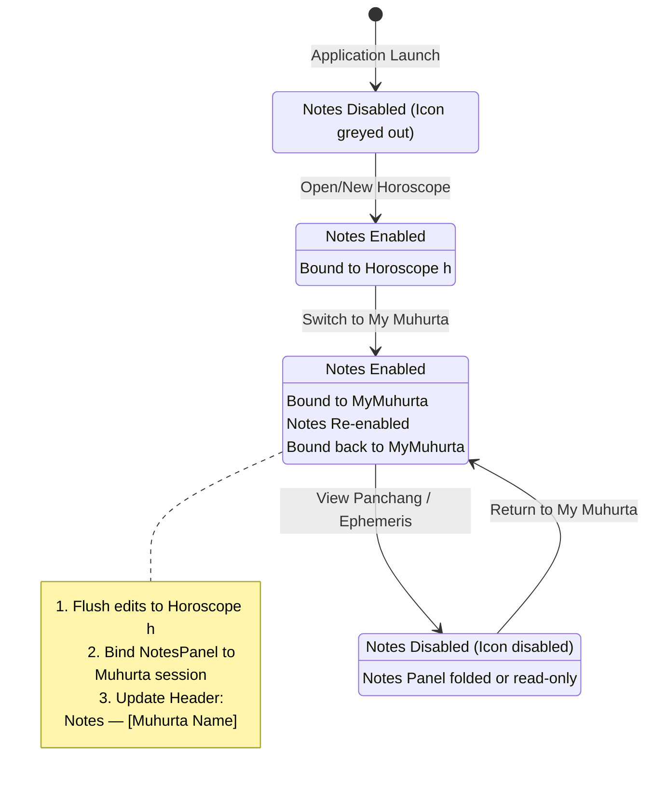

# Notes Architecture & Design Specification

## 1. Overview & Core Philosophy

The Notes subsystem in Astrosoft provides a persistent, rich-text scratchpad where users can record astrological observations, client consultation notes, muhurta rationales, and matching evaluations.

### The Fundamental Principle: "Document-Bound Notes"
Notes are not ephemeral UI states; **notes are always bound to a specific document entity**. 
- In Astrosoft, a **Document** is any entity that can be saved to or loaded from a persistent `.ash` file (e.g., a Natal Horoscope, a Muhurta Analysis session, or a Marriage Compatibility record).
- **Utility / Lookup views** (such as daily Panchang, Ephemeris tables, or Baby Name search) do not have a persistent document identity; therefore, Notes are **disabled** when viewing them.

---

## 2. Screen & View State Matrix

| Screen / View | Category | Notes State | Owning Entity | Target `.ash` Persistence |
| :--- | :--- | :---: | :--- | :--- |
| **Chart View** (Rasi / Navamsa) | Horoscope | **ENABLED** | `Horoscope` (`h.getNotes()`) | `<BirthData><Notes>` in Horoscope `.ash` |
| **Vimshottari Dasas** | Horoscope | **ENABLED** | `Horoscope` (`h.getNotes()`) | `<BirthData><Notes>` in Horoscope `.ash` |
| **Planetary Positions** | Horoscope | **ENABLED** | `Horoscope` (`h.getNotes()`) | `<BirthData><Notes>` in Horoscope `.ash` |
| **Bhava (House) Positions** | Horoscope | **ENABLED** | `Horoscope` (`h.getNotes()`) | `<BirthData><Notes>` in Horoscope `.ash` |
| **Divisional Charts (D2–D60)** | Horoscope | **ENABLED** | `Horoscope` (`h.getNotes()`) | `<BirthData><Notes>` in Horoscope `.ash` |
| **Ashtavarga** | Horoscope | **ENABLED** | `Horoscope` (`h.getNotes()`) | `<BirthData><Notes>` in Horoscope `.ash` |
| **Shadbala** | Horoscope | **ENABLED** | `Horoscope` (`h.getNotes()`) | `<BirthData><Notes>` in Horoscope `.ash` |
| **Yoga Combinations** | Horoscope | **ENABLED** | `Horoscope` (`h.getNotes()`) | `<BirthData><Notes>` in Horoscope `.ash` |
| **My Muhurta View** | Muhurta | **ENABLED** | `MyMuhurta` (`muhurta.getNotes()`) | `<Muhurta><Notes>` in Muhurta `.ash` |
| **Marriage Match View** *(Future)* | Compatibility | **ENABLED** | `Compactibility` (`comp.getNotes()`) | `<Compactibility><Notes>` in Match `.ash` |
| **Compatibility View** *(Future)* | Compatibility | **ENABLED** | `Compactibility` (`comp.getNotes()`) | `<Compactibility><Notes>` in Match `.ash` |
| **Daily Panchang** | Utility / Lookup | **DISABLED** | *None* | *None (Reference only)* |
| **Ephemeris View** | Utility / Lookup | **DISABLED** | *None* | *None (Reference only)* |
| **Find Baby Name** | Utility / Lookup | **DISABLED** | *None* | *None (Reference only)* |
| **Initial Empty State** | Application | **DISABLED** | *None* | *None* |

---

## 3. Architecture & Domain Model

### 3.1 The `NotesOwner` Interface
To decouple `ChartNotesPanel` from `Horoscope` and enable seamless scaling to **My Muhurta** and **Marriage Match**, document classes implement a lightweight interface:

```java
package app.astrosoft.beans;

public interface NotesOwner {
    /** Returns current notes content (HTML or plain text) */
    String getNotes();

    /** Sets notes content */
    void setNotes(String notes);

    /** Descriptive title for Notes header/tooltip (e.g. "Notes — Nikhil" or "Notes — House Warming") */
    String getNotesOwnerTitle();

    /** Returns whether this document has an associated file path */
    String getFilePath();

    /** Marks the underlying document as modified */
    void setModified(boolean modified);
}
```

### 3.2 Implemented By:
1. **`Horoscope` (via `BirthData`):**
   - Title: `h.getPersonName()` (e.g., `Notes — Nikhil`)
   - Storage: `<BirthData><Notes><![CDATA[...]]></Notes></BirthData>`
2. **`MyMuhurta`:**
   - Title: `Event Name / Date` (e.g., `Notes — House Warming [27 Oct 2026]`)
   - Storage: `<Muhurta><Notes><![CDATA[...]]></Notes></Muhurta>`
3. **`Compactibility` (Marriage Match - Planned):**
   - Title: `BoyName & GirlName` (e.g., `Notes — Rohit & Priya`)
   - Storage: `<Compactibility><Notes><![CDATA[...]]></Notes></Compactibility>`

---

## 4. Lifecycle & Context-Switching Protocol

When navigating across views in `AstroSoft.java`:



### Step-by-Step Context Switching Rules:
1. **Flush Before Switching (`flushCurrentNotes()`):**
   - Before leaving the current view, `AstroSoft` calls `chartNotesPanel.flushToOwner()`.
   - This writes any pending HTML text from the editor into the active `NotesOwner` memory object so edits are never lost.
2. **Bind New Owner (`bindNotesOwner(NotesOwner owner)`):**
   - When entering a document screen, `AstroSoft` passes the new `NotesOwner` to `chartNotesPanel`.
   - The editor loads `owner.getNotes()`, resets its undo manager, and sets the title/tooltip to `owner.getNotesOwnerTitle()`.
   - The toolbar `Command.NOTES` action is enabled (`true`).
3. **Handle Utility Views (`clearNotesOwner()`):**
   - When entering `PANCHANG_VIEW`, `EPHEMERIS_VIEW`, or `FIND_NAME_VIEW`, `AstroSoft` sets the active notes owner to `null`.
   - The toolbar `Command.NOTES` action is disabled (`false`).
   - If the Notes dock is currently open, it displays a disabled placeholder or safely folds without modifying any file.

---

## 5. Save & Dirty State Integration

1. **Typing Listener:**
   - When the user edits text in `ChartNotesPanel`, `NotesListener.onNotesModified()` fires.
   - This marks the active `NotesOwner` as modified and enables `Command.SAVE` and `Command.SAVE_AS` on the main toolbar.
2. **Toolbar Save Trigger (`saveHoroscope()` / `saveDocument()`):**
   - Clicking **Save**:
     - Flushes the editor to the active `NotesOwner`.
     - Writes to the active document's `.ash` file:
       - If active screen is a **Horoscope view**, saves the `Horoscope`.
       - If active screen is **My Muhurta**, saves the `MyMuhurta` `.ash` file.
       - If active screen is **Marriage Match**, saves the `Compactibility` `.ash` file.
   - If the active document has no file path yet, triggers **Save As** with the `.ash` file chooser.

---

## 6. XML Schema Specification (`.ash`)

All persistent records share the `.ash` file extension. The root XML element dictates document identity and parser routing:

### 6.1 Horoscope Document (`.ash`)
```xml
<BirthData>
  <Name>Nikhil</Name>
  <Sex>Male</Sex>
  <Date>15</Date>
  <Month>8</Month>
  <Year>1985</Year>
  <Hour>10</Hour>
  <Minute>30</Minute>
  <Place city="Chennai" latitude="13.0827" longitude="80.2707" timezone="5.5" />
  <Notes><![CDATA[<html><body><p>Consultation note for career...</p></body></html>]]></Notes>
</BirthData>
```

### 6.2 My Muhurta Document (`.ash`)
```xml
<Muhurta version="2.0">
  <Event>
    <Name>House Warming</Name>
    <Date>2026-10-27</Date>
    <Time>11:17:49</Time>
    <Place city="Ramachandrapuram" latitude="16.85" longitude="82.02" timezone="5.5" />
  </Event>
  <Person1 type="Horoscope">
    <!-- Standalone BirthData excluding person's private horoscope notes -->
    <BirthData>
      <Name>HouseWarming-Husband</Name>
      ...
    </BirthData>
  </Person1>
  <Person2 type="QuickEntry">
    <Name>HouseWarming-Wife</Name>
    <Rasi>Mesha</Rasi>
    <Nakshathra>Aswini</Nakshathra>
  </Person2>
  <Notes><![CDATA[<html><body><p>Recommended Subha Hora window 08:51 AM - 09:49 AM...</p></body></html>]]></Notes>
</Muhurta>
```

### 6.3 Marriage Compatibility Document (`.ash` / planned)
```xml
<Compactibility version="2.0" hasHoroscope="true">
  <BoyData>...</BoyData>
  <GirlData>...</GirlData>
  <Notes><![CDATA[<html><body><p>Guna Milan score 28/36. Excellent match for marriage...</p></body></html>]]></Notes>
</Compactibility>
```

---

## 7. Auto-Routing on `File -> Open`

When the user invokes `File -> Open` (or clicks the Open toolbar icon) and selects any `.ash` file:
1. `AstroSoft` reads the root element via `XMLHelper.parseXML(...)`:
   - Root is `<BirthData>`: Instantiates `Horoscope`, binds notes, routes to `CHART_VIEW`.
   - Root is `<Muhurta>`: Instantiates `MyMuhurta`, binds notes, routes to `MY_MUHURTA_VIEW`.
   - Root is `<Compactibility>`: Instantiates `Compactibility`, binds notes, routes to `MARRIAGE_MATCH_VIEW`.
2. Title bar updates accordingly:
   - `Astrosoft 2.0 - Nikhil.ash`
   - `Astrosoft 2.0 - HouseWarming.ash [Muhurta]`
   - `Astrosoft 2.0 - Rohit-Priya.ash [Marriage Match]`
