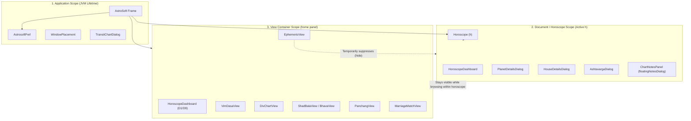

# Astrosoft UI & Presentation Layer Architecture

**Document Version:** 1.0.0  
**Status:** Approved Architectural Standard  
**Target:** Astrosoft 2.0 (Java 21 LTS / Swing)  
**Primary Audience:** Core maintainers and autonomous AI agents modifying UI code.

---

## 1. Overview & Architectural Philosophy

Astrosoft's presentation layer is built exclusively with **Java Swing (Java 21 LTS)**. Unlike modern reactive web frameworks (e.g., React, Flutter) where state changes trigger automatic top-down re-renders across a unified virtual DOM, Swing is an **imperative, component-based desktop framework**.

In Astrosoft, the UI is divided into two fundamentally distinct operating environments:
1. **The Embedded View Container (`home` panel hierarchy)**: Panels mounted inside `AstroSoft`'s main split pane. Managed declaratively by `ViewManager`.
2. **Modeless Floating Companion Palettes (`JDialog` window peers)**: Detached top-level OS windows (`PlanetDetailsDialog`, `HouseDetailsDialog`, `AshtavargaDialog`, `TransitChartDialog`, `floatingNotesDialog`).

> [!IMPORTANT]
> **Swing Window Ownership vs. Event Propagation:**  
> Establishing a parent-child window relationship in Swing (`new JDialog(owner)`) only governs OS-level window mechanics (minimizing with owner, z-order stacking, and taskbar bundling). **It does NOT propagate domain events or preference updates.**  
> Whenever application preferences (Language, Ayanamsa, Rahu Node, Theme, Style) change, the orchestrator (`AstroSoft.java`) must explicitly push updates across **both** the embedded view tree and all active floating dialogs.

---

## 2. Window Tier Classification & Modality Rules

All windows in Astrosoft strictly belong to one of three tiers:

```
┌────────────────────────────────────────────────────────────────────────┐
│ Tier A: Main Application Shell (AstroSoft JFrame)                       │
│   • Single top-level application container                             │
│   • Global menu bar, action dispatchers, toolbars                      │
│   • Dynamic home container (JSplitPane holding ViewManager panels)     │
└───────────────────────────────────┬────────────────────────────────────┘
                                    │
       ┌────────────────────────────┴───────────────────────────┐
       ▼                                                        ▼
┌────────────────────────────────────────┐   ┌─────────────────────────────────────────┐
│ Tier B: Modal Input & Alerts           │   │ Tier C: Modeless Companion Palettes     │
│ (`AstrosoftDialog` / APPLICATION_MODAL)│   │ (`JDialog` / MODELESS)                  │
│   • Birth Data Input / Place Options   │   │   • PlanetDetailsDialog                 │
│   • AboutDialog / OptionDialog         │   │   • HouseDetailsDialog                  │
│   • FileOps file chooser dialogs       │   │   • AshtavargaDialog                    │
│                                        │   │   • TransitChartDialog                  │
│   CONTRACTS:                           │   │   • floatingNotesDialog                 │
│   • ModalityType.APPLICATION_MODAL     │   │                                         │
│   • alwaysOnTop = true while active    │   │   CONTRACTS:                            │
│   • Must stay above all floating cards │   │   • alwaysOnTop = false strictly        │
│   • windowOpened elevation hooks       │   │   • Must NEVER occlude modal popups     │
└────────────────────────────────────────┘   └─────────────────────────────────────────┘
```

### Invariant Rules:
1. **No Raw JOptionPane Calls**: Prompts and alerts must route through `OptionDialog.showDialog(...)` which guarantees proper parent binding and topmost z-order.
2. **File Pickers**: Must use `FileOps.openFileDialog(...)` or `FileOps.saveFileDialog(...)` to guarantee that modal file choosers are elevated over floating cards.
3. **Modeless Palettes Keep `alwaysOnTop = false`**: Floating cards act as reference heads-up displays (HUDs). They must never have `alwaysOnTop=true`, ensuring modal popups naturally take precedence.

---

## 3. Scope & Lifetime Hierarchy

Floating and embedded UI components have three distinct lifetime scopes:



### Scope Summary Matrix

| Scope | Lifetime Trigger | Components | Lifecycle Management |
|---|---|---|---|
| **1. Application Scope** | Lifetime of application process | `AstroSoft`, `preferences`, `WindowPlacement`, `TransitChartDialog` | Survives opening and closing charts. Must refresh whenever global options (Language, Theme, Style, Ephemeris settings) change. |
| **2. Document / Horoscope Scope** | Lifetime of currently loaded `Horoscope (h)` | `HoroscopeDashboard`, `PlanetDetailsDialog`, `HouseDetailsDialog`, `AshtavargaDialog`, `floatingNotesDialog` | • **Teardown**: Completely disposed (`cleanupChartFloatingDialogs()`) on `File -> New`, `File -> Open`, or birth data edits.<br/>• **Suppression**: Auto-hidden (`setVisible(false)`) when entering non-chart utility screens (Ephemeris, Panchang, Marriage Match) and restored upon returning.<br/>• **Navigation**: Remains visible when switching between horoscope views (Dasa, Divisional, Shadbala). |
| **3. View Container Scope** | Lifetime of active panel in `home` | Embedded screens (`VimDasaView`, `DivChartView`, etc.) | Reconstructed or swapped by `ViewManager.showView()`. |

---

## 4. Preference & Domain Event Propagation Contract

When a user modifies runtime options via the `Options` menu, `AstroSoft.optionChanged(...)` is the central coordinator.

### The Two-Pronged Propagation Rule:
Whenever any preference changes:
1. **Prong 1: Embedded Views**: Must update the current document and rebuild the mounted view:
   - `viewManager.showView(...)`
   - `refreshAllChartsAndCachedViews()` (iterates child charts across `home`).
2. **Prong 2: Floating Palettes**: Must rebuild all active modeless dialogs while preserving their exact user-adjusted screen bounds:
   - `refreshChartFloatingDialogs()`

```java
// Central dispatcher in AstroSoft.java
public void optionChanged(Preference preference, Object value) {
    preferences.preferenceChanged(preference, value);
    switch (preference) {
        case Language:    optionLangChanged(((Language) value).name()); break;
        case Ayanamsa:    optionAyanamsaChanged((Ayanamsa) value); break;
        case RahuNode:    optionRahuNodeChanged((RahuNode) value); break;
        case ChartTheme:  optionThemeChanged((ChartTheme) value); break;
        case ChartStyle:  optionStyleChanged((ChartStyle) value); break;
    }
}
```

### Dialog Refresh Implementation Pattern:
```java
private void refreshChartFloatingDialogs() {
    // 1. Refresh Horoscope-scoped dialogs if a horoscope is loaded
    if (h != null) {
        PlanetDetailsDialog pd = PlanetDetailsDialog.getActiveDialog();
        Rectangle pdBounds = (pd != null && pd.isDisplayable() && pd.isVisible()) ? pd.getBounds() : null;
        if (pdBounds != null) {
            PlanetDetailsDialog.closeActiveDialog();
            PlanetDetailsDialog reopened = PlanetDetailsDialog.showDialog(this, h, () -> syncCheckbox(false));
            reopened.setBounds(pdBounds);
        }
        // Repeat for HouseDetailsDialog and AshtavargaDialog...
    }

    // 2. Refresh Application-scoped dialogs (independent of h)
    if (transitChartDialog != null && transitChartDialog.isDisplayable() && transitChartDialog.isVisible()) {
        Rectangle tdBounds = transitChartDialog.getBounds();
        Date instant = transitChartDialog.getSelectedInstant();
        Place place = transitChartDialog.getCurrentPlace();
        boolean expanded = transitChartDialog.isExpanded();

        transitChartDialog.dispose();
        transitChartDialog = new TransitChartDialog(this, instant, place);
        if (expanded) transitChartDialog.setExpanded(true);
        transitChartDialog.setBounds(tdBounds);
        transitChartDialog.setVisible(true);
    }
}
```

---

## 5. Localization & Dynamic Font Rendering Architecture

### 5.1 Resource Bundles & Domain Lookups
- Astrological constants (`Planet`, `Rasi`, `Nakshathra`, `Thithi`, `Yoga`, etc.) use strongly-typed enums whose `toString()` delegates to `Internalization.getString(key)`.
- Localization bundles live in `resources/AstrosoftBundle_en.properties` and `resources/AstrosoftBundle_ta.properties`.
- **Missing Translation Safeguard**: Any lookup failing in `Internalization.java` logs to `logs/missing_translations.log` for offline dictionary updates.

### 5.2 Dual-Script System Font Prioritization
Tamil and Sanskrit terms often appear side-by-side with Latin digits, English abbreviations, and degree glyphs (e.g., `12° Cp 35' (AK)`). Astrosoft resolves system fonts via `UIUtil.getTamilFontName()` using OS-aware dual-script prioritization:
* **macOS**: `Tamil Sangam MN` or `Tamil MN` (high-quality native dual-script fonts that render Latin numerals and Tamil ligatures cleanly without vertical displacement).
* **Windows**: `Nirmala UI` (native Microsoft Indic dual-script font introduced in Windows 8/10/11) with fallback to bundled `Noto Sans Tamil`.
* **Linux / Cross-Platform Fallback**: Bundled `Noto Sans Tamil` registered at runtime.

### 5.3 Rich-Text Notes Localization
In `ChartNotesPanel`, HTML notes rendering employs an explicit CSS fallback stack:
```css
font-family: Arial, 'Nirmala UI', 'Noto Sans Tamil', 'Tamil Sangam MN', Helvetica, sans-serif;
```
This guarantees that pasting or typing Tamil text into consultation notes renders without glyph tofu or font substitution errors on all supported OSes.

---

## 6. Testing & Invariant Verification Plan

Whenever touching UI components, layouts, dialogs, or themes, the following verification gates must pass:

1. **Floating Lifecycle & Preferences Suite**:
   ```bash
   ant test -Dtestcase=app.astrosoft.ui.test.FloatingDialogsLifecycleTest
   ```
   Validates single-instance tracking, scope disposal, z-order modality, and dynamic refresh on Language and Lunar Node switches.
2. **13 Legacy Screens Contract**:
   ```bash
   ./.agents/skills/astrosoft-regression-guardian/scripts/run_legacy_regression.sh
   ```
   Validates offscreen layout and rendering across all 13 original screens without `NullPointerException` or `HeadlessException`.
3. **Full UI Smoke Suite**:
   ```bash
   ./.agents/skills/astrosoft-regression-guardian/scripts/run_ui_smoke.sh
   ```
   Must produce `SUCCESS: All UI smoke tests passed without regressions!` across all 7 test classes.
